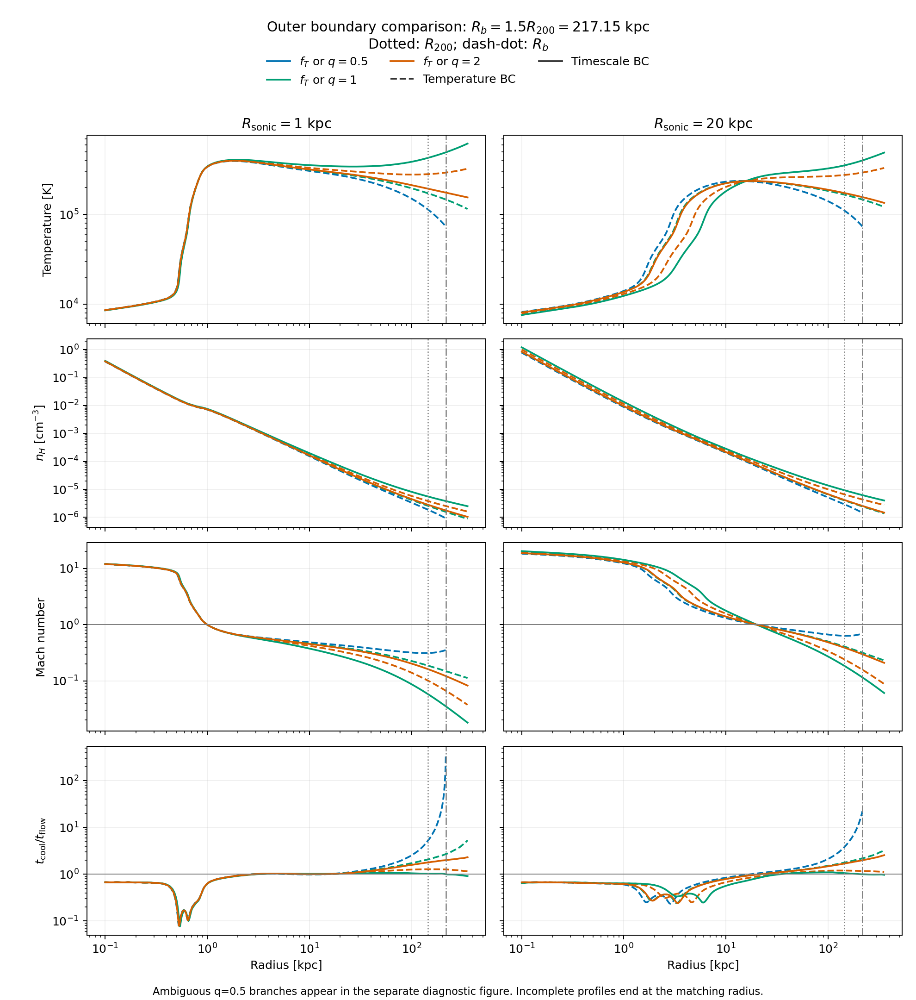
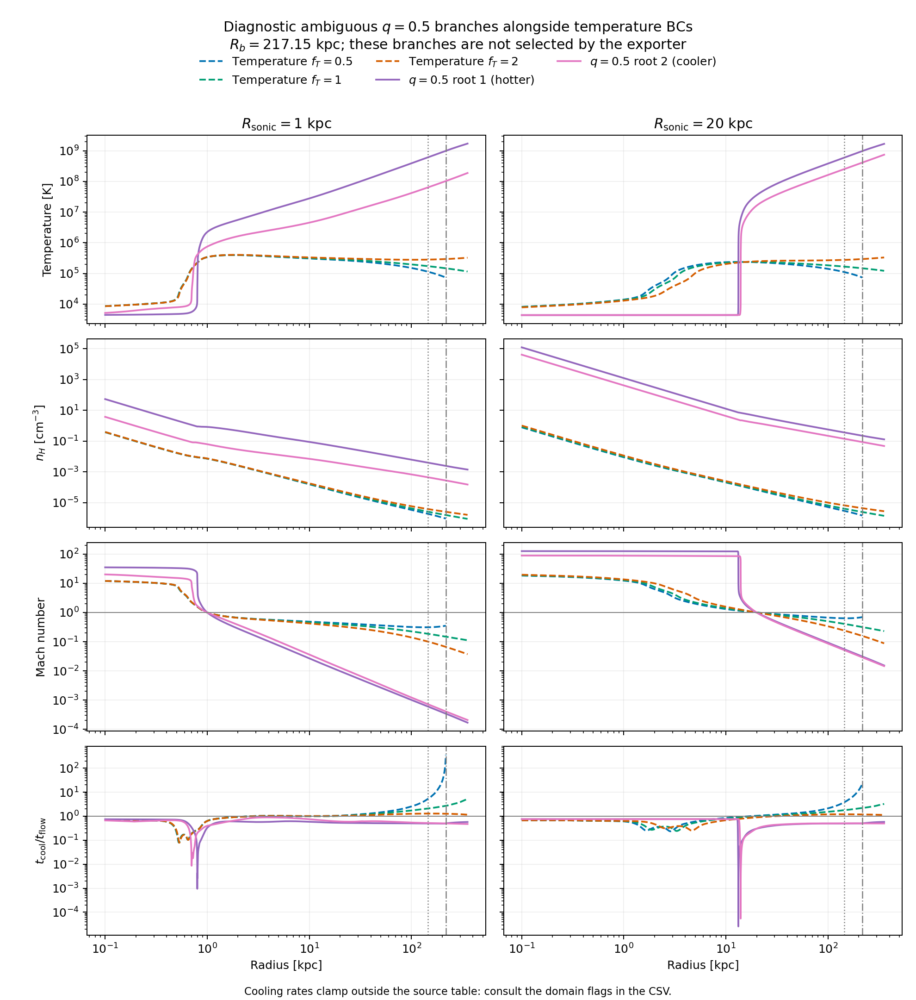

# Outer boundary comparison

The optional timescale condition sets

$$
q_b = \frac{t_{\rm cool}(R_b)}{t_{\rm flow}(R_b)},\qquad
 t_{\rm flow}=\frac{r}{|v|}.
$$

The fiducial ratio is $q_b=1$. Cooling time uses the signed net Wiersma cooling rate and the same thermal-energy convention as the flow ODE. A heating-dominated boundary does not satisfy this positive cooling-time condition. The temperature alternative sets $c_s^2(R_b)=f_Tv_c^2(R_b)$, with adiabatic sound speed. Only one condition is imposed in a run.

Both conditions use the spherical angular average of the full fiducial GOTHAM gravity, including stellar disk gravity, and $R_b=1.5R_{200}=217.1510$ kpc. These are CGM flow comparisons without an initial gas disk contribution to the quoted mass. The CGM mass is integrated from 0.1 kpc to $R_{200}=144.7674$ kpc. The mesh, including ghost cells, needs radial coverage to 354.5291 kpc.



Solid lines use the timescale condition; dashed lines use the temperature condition. Colors identify the numerical value 0.5, 1, or 2 for the respective parameter. The bottom panels show the actual cooling-to-flow-time ratio in both families. The factors in the two modes have different physical meanings: matching colors are a visual convention, not equivalent boundary states.

## Results

| Sonic radius [kpc] | BC | Factor | $T(R_b)$ [K] | $\dot M$ [$M_\odot$ yr$^{-1}$] | $M_{\rm CGM}(<R_{200})$ [$10^9 M_\odot$] | Coverage |
|---:|:---|---:|---:|---:|---:|:---|
| 1 | Temperature | 0.5 | 73,504 | 0.26208 | 1.681 | Boundary only |
| 1 | Temperature | 1 | 147,008 | 0.26501 | 2.047 | Full mesh |
| 1 | Temperature | 2 | 294,016 | 0.27126 | 2.754 | Full mesh |
| 1 | Timescale, diagnostic hotter root | 0.5 | 995,939,563 | 77.94779 | 2742.261 | Full mesh; ambiguous |
| 1 | Timescale, diagnostic cooler root | 0.5 | 102,516,911 | 3.39124 | 292.873 | Full mesh; ambiguous |
| 1 | Timescale | 1 | 494,650 | 0.27988 | 3.773 | Full mesh |
| 1 | Timescale | 2 | 175,521 | 0.26617 | 2.181 | Full mesh |
| 20 | Temperature | 0.5 | 73,504 | 0.81244 | 2.544 | Boundary only |
| 20 | Temperature | 1 | 147,008 | 0.88446 | 3.143 | Full mesh |
| 20 | Temperature | 2 | 294,015 | 1.10155 | 4.649 | Full mesh |
| 20 | Timescale, diagnostic hotter root | 0.5 | 979,613,196 | 638962.225 | 255922.643 | Full mesh; ambiguous |
| 20 | Timescale, diagnostic cooler root | 0.5 | 410,622,356 | 150490.955 | 98115.162 | Full mesh; ambiguous |
| 20 | Timescale | 1 | 401,647 | 1.34618 | 6.288 | Full mesh |
| 20 | Timescale | 2 | 156,501 | 0.89534 | 3.225 | Full mesh |

The fiducial $q_b=1$ solutions are hotter and contain more CGM than the $f_T=1$ solutions. At a sonic radius of 1 kpc, mass inflow increases by 5.6% and enclosed CGM mass by 84%; at 20 kpc the increases are 52% and 100%. Their equivalent temperature parameters are $f_T=3.365$ and 2.732. Their outer cooling and flow times are both 57.67 and 19.56 Gyr, respectively: equality does not mean either timescale is short.

Increasing $q_b$ from 1 to 2 selects cooler outer states and less enclosed gas in the matched branches. This is consistent with the ratio specifying an entropy gradient rather than an outer temperature directly: the steady entropy equation gives $d\ln(P/\rho^\gamma)/d\ln r=1/q_b$.

The $q_b=0.5$ condition has two detected roots at each sonic radius. The production solver refuses to choose between them. The comparison script resolves and plots both as diagnostics, without adding a branch-selection default to the generator. Detection uses the union of linear and logarithmic grids in sonic parameter $x=v_c^2/(2c_s^2)$, followed by a bracketed solve for each sign change. This search does not establish global uniqueness or exhaust all possible branches.



These are mathematically resolved solutions of the implemented equations, but they are implausible CGM initial conditions in the fixed GOTHAM potential. Their outer temperatures are $10^8$–$10^9$ K and the enclosed gas masses exceed the NFW halo mass. The input NFW normalization gives $M_{\rm NFW}(<R_{200})=1.09260\times10^{11}M_\odot$. The hotter and cooler roots contain, respectively, 25.10 and 2.681 times that mass at a 1 kpc sonic radius, and 2342 and 898 times it at 20 kpc. Neglecting their gas self-gravity would be inconsistent. These mass ratios are relative to the NFW component alone; stellar and outer halo gravity are still included in the flow integration. The full spherical gravity at $R_{200}$ corresponds to an enclosed mass $R_{200}v_c^2/G=1.30838\times10^{11}M_\odot$. Even the least massive diagnostic branch exceeds that full mass by a factor of 2.24, so adding the stellar and outer halo terms does not resolve the self-gravity inconsistency.

All four diagnostic branches also leave the source cooling table domain. Their maximum hydrogen densities are 52.84 and 3.723 cm$^{-3}$ at 1 kpc, and $1.2143\times10^5$ and $4.0559\times10^4$ cm$^{-3}$ at 20 kpc; the table ends at 1 cm$^{-3}$. The hotter roots exceed the table maximum temperature of $9.5907\times10^8$ K as well. The rates clamp at those edges. Thus the detailed hot-branch values depend on this cooling-table approximation and should not be treated as validated physical predictions. They are shown separately so their extreme scales do not hide the ordinary CGM comparison.

Both $f_T=0.5$ solutions match at the boundary but fail mesh extension near 334.07 kpc (1 kpc sonic radius) and 260.74 kpc (20 kpc sonic radius). They are plotted only through $R_b$. In the former case the ODE step size fails; the latter explicitly encounters another sonic point. The exporter requires full mesh coverage.

## Checks and limits

For all fourteen matched profiles, including four diagnostic ambiguous branches, dense-output boundary evaluation gives fractional residuals below $2.5\times10^{-6}$. Saved profiles cover the requested inner endpoint, are strictly ordered, and have finite positive temperature, density, and Mach number. Full-coverage cases reach the outer mesh endpoint. No interpolation is performed outside the computed radial interval.

All 69 repository tests pass, including the notebook checks, recovery of a known
timescale solution, entropy-slope consistency, potential-offset invariance, and
rejection of narrow multiple-root pairs. Actual CLI exports at both sonic radii
reproduce $q_b=1$ from the saved tables to better than $4\times10^{-8}$, cover the
full mesh, and preserve the template's 1 Gyr timing. The disk and cluster tables
are unchanged. The compiled GOTHAM comparison also passes, with relative errors
$6.06\times10^{-15}$ in gravity and $6.99\times10^{-6}$ in cooling.

The CSV explicitly flags excursions outside the source Wiersma table domain; these are comparison diagnostics, rather than a new exporter rejection rule. The 20 kpc, $q_b=1$ solution reaches $n_H=1.206$ cm$^{-3}$ near the innermost endpoint, above the table maximum of 1 cm$^{-3}$; the solver clamps the cooling rate there. The 20 kpc, $f_T=2$ case barely exceeds it ($n_H=1.007$ cm$^{-3}$). The ten ordinary matched outer boundary states remain inside the table domain. These central density limits should be considered separately from the validity of the outer boundary matching.

These calculations do not test a 1 Gyr hydrodynamic relaxation or prove global uniqueness of the cooling-flow family.

## Reproduce

From `external/CGM_ICs`, using a Python environment with the repository dependencies:

```sh
python compare_outer_boundaries.py --output-dir ../../build/outer-boundaries
```

The optional `--r-boundary-kpc` overrides the default $1.5R_{200}$. The comparator uses tabulated gravity and adaptive integration with absolute and relative tolerances $10^{-10}$ and sonic offset $10^{-4}$. It saves the source input, parameter JSON, one physical-unit NPZ profile per matched branch, summary CSV, and PNG/PDF figures. The four diagnostic ambiguous branches have explicit branch identifiers and are plotted separately alongside the temperature BCs. The exporter continues to reject the ambiguous target.

The tracked [CSV](outer_boundary_comparison.csv), [ordinary comparison PDF](outer_boundary_comparison.pdf), and [ambiguous branch PDF](outer_boundary_ambiguous.pdf) accompany the figures. Full physical profiles are in the generated output directory rather than committed as binary data.
