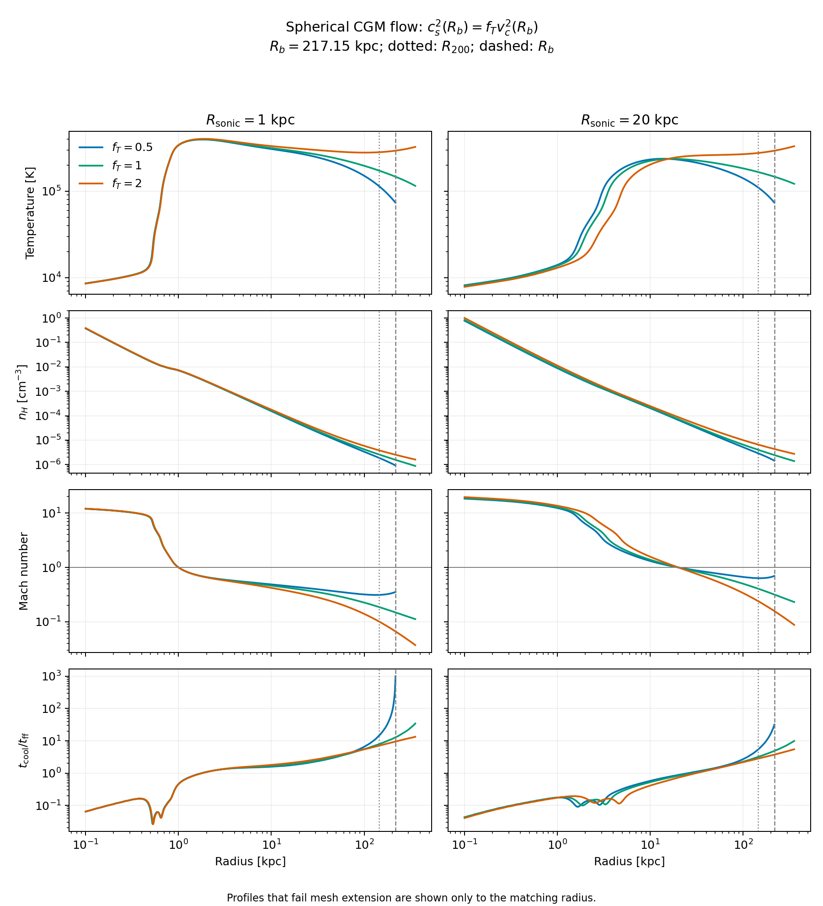

# Outer-temperature boundary comparison

The six requested cooling flows all match the imposed temperature at
$R_b=1.5R_{200}=217.151$ kpc. The $f_T=1$ and 2 solutions cover the complete
fiducial GOTHAM mesh. The $f_T=0.5$ solutions encounter a second sonic point
outside $R_b$ but inside the mesh's outer corners, so they cannot supply that
whole mesh as smooth steady flows.

## Definition and inputs

The new GOTHAM export mode solves

$$
T(R_b)=f_T\frac{\mu m_p}{\gamma k_B}v_c^2(R_b),
\qquad v_c^2(r)=r\frac{d\bar\Phi}{dr},
\qquad \bar\Phi=\int_0^1\Phi(r\sqrt{1-\mu_\theta^2},r\mu_\theta)\,d\mu_\theta.
$$

Here $c_s$ is the **adiabatic** sound speed: $f_T=1$ means $c_s=v_c$.
Both $f_T$ and $R_b$ are parameters. The default radius is calculated from the
input's `potential/r_200`, not the mesh size. A force-based temperature scale
avoids the arbitrary potential zero and undefined escape speed of the
confining outer-halo term. This is a chosen outer thermodynamic condition,
not a claim that every halo has this temperature.

The input is `inputs/gotham/athinput.gotham` from AthenaK `gotham_dev` commit
`a9afe1e6864e45ae4b0adc74f0710fc28ee77974`. Its $R_{200}=144.767$ kpc.
The full NFW, stellar-disk, and outer-halo gravity is angularly averaged for
the CGM calculation. Gas self-gravity is absent. Cooling is the existing
optically thin, $z=0$ Wiersma table with gas metallicity $Z=1/3$ solar.
The comparison contains CGM gas only; the stellar disk's gravitational force
is retained. Gas-disk and star-cluster generation in the production exporter
is unchanged, as is the template's 1 Gyr supernova delay and run end.

At fixed sonic radius, the shooting parameter is
$x=v_c^2(R_s)/(2c_s^2(R_s))$. Sonic regularity fixes the density and mass inflow
rate for each trial. The solver selects the negative Mach-gradient branch,
integrates outward, and matches the actual temperature residual at $R_b$.
Failed integrations do not count as cold boundary values. After matching, it
integrates inward to 0.1 kpc and extends outward to the required table radius.
Changing the table endpoint does not reselect the flow.

## Results

The target temperatures for $f_T=0.5,1,2$ are respectively 73,504, 147,008,
and 294,015 K. The following masses integrate CGM gas from 0.1 kpc to $R_{200}$.
The complete mesh, including corner ghost cells, needs a profile out to
354.529 kpc.

| $R_s$ [kpc] | $f_T$ | $T(R_s)$ [K] | $\dot M$ [$M_\odot$/yr] | $M_{\rm CGM}(<R_{200})$ [$10^9M_\odot$] | Whole mesh covered? |
| ---: | ---: | ---: | ---: | ---: | :--- |
| 1 | 0.5 | 339,671 | 0.26208 | 1.681 | No: second sonic point at 334.065 kpc |
| 1 | 1 | 340,381 | 0.26501 | 2.047 | Yes |
| 1 | 2 | 341,874 | 0.27126 | 2.754 | Yes |
| 20 | 0.5 | 231,252 | 0.81244 | 2.544 | No: second sonic point at 260.744 kpc |
| 20 | 1 | 235,690 | 0.88446 | 3.143 | Yes |
| 20 | 2 | 247,782 | 1.10155 | 4.649 | Yes |



[PDF figure](outer_temperature_comparison.pdf) · [Numerical results](outer_temperature_comparison.csv)

For $R_s=1$ kpc the inner flow is almost independent of the outer condition:
the full $f_T$ range changes $\dot M$ by only 3.5%. Nevertheless, CGM mass inside
$R_{200}$ changes by 64%. For $R_s=20$ kpc the inner solution is more sensitive:
$\dot M$ changes by 36% and enclosed CGM mass by 83%. A hotter outer boundary
produces a shallower outer density decline and more enclosed gas; it does not
simply multiply the temperature everywhere.

$f_T=1$ is a useful baseline for the next comparison: both sonic radii supply
the current mesh and its normalization is easy to interpret. $f_T=2$ is a
useful hotter, more massive comparison. The $f_T=0.5$ profiles are valid up to
the matching radius, but require a smaller simulation domain or a different
outer flow model to cover the current box. The exporter rejects incomplete
coverage rather than padding those profiles. Their plotted curves stop at
$R_b$, before the additional outer sonic point.

## Verification and limits

- All six boundary residuals are below $2\times10^{-11}$ in fractional
  temperature. This measures numerical matching, not physical accuracy.
- For $f_T=1$, halving the log-radius step from 0.002 to 0.001 and the sonic
  offset from $10^{-4}$ to $5\times10^{-5}$ changes $\dot M$ by
  $6.0\times10^{-8}$ and $4.2\times10^{-8}$ for the two sonic radii.
- Away from $|\ln(r/R_s)|<0.003$, maximum temperature differences are
  $1.07\times10^{-4}$ and $6.52\times10^{-6}$; maximum density and velocity
  differences are below $4\times10^{-6}$. Integrated entropy and momentum
  residuals decrease with resolution.
- The Python suite passed 43 tests including notebook execution. The 12
  outer-temperature tests also pass, including the subsequently added exact
  scan-node match, potential-offset invariance, independent table extent,
  impossible-target rejection, and physical outer-extension failure.
- The actual GOTHAM C++ potential and cooling regression passes: maximum
  relative gravity discrepancy $6.06\times10^{-15}$ and scaled cooling-rate
  discrepancy $6.99\times10^{-6}$ across 2048 samples.

The branch search samples $10^{-5}\le x\le1-10^{-5}$, refines successful/failed
transitions, and rejects detected multiple brackets. It does not prove global
uniqueness or nonexistence in other potentials. The boundary temperature must
exceed the solver's 20,000 K outer-branch floor. The comparison used a maximum
log-radius step of 0.01; the original production exports used 0.002. After merging
the upstream optimizations, production exports use tabulated gravity and
adaptive integration at $10^{-10}$ tolerances, then sample dense output with a
maximum log-radius spacing of 0.002. Both temperature targets use GOTHAM's
historical constants.

The merged fast solver matches all six boundary targets within $2.5\times10^{-6}$
and retains the same four successful mesh extensions and two outer sonic-point
failures. At $f_T=1$, the 1 and 20 kpc mass inflow rates differ from the saved
original exports by less than $6\times10^{-8}$ fractionally. The tighter adaptive
tolerance is needed because $10^{-9}$ produced a noisy temperature residual for
the fiducial 1 kpc flow. The acceptance tolerance was not loosened.

No 1 Gyr relaxation or full three-dimensional evolution was run. In particular,
this does not remove the intended need to relax spherical ICs in the full
nonspherical gravitational field, or establish a maximum possible sonic radius.

## Reproduce

From the IC repository inside AthenaK, with its Python dependencies installed:

```bash
python compare_outer_temperature.py --output-dir ../../build/outer-temperature
python generate_gotham_ics.py ../../inputs/gotham/athinput.gotham ../../build/run-rs20 --r-sonic 20 --f-t 1
```

The comparison accepts `--athinput` and `--r-boundary-kpc`; the exporter accepts
`--r-boundary`. Both radii are in physical kpc. Without an override, both use
$1.5R_{200}$. Output directories must be new. The comparison writes the input
snapshot, boundary parameters, CSV summary, six physical-unit NPZ profiles,
and PNG/PDF figures.
